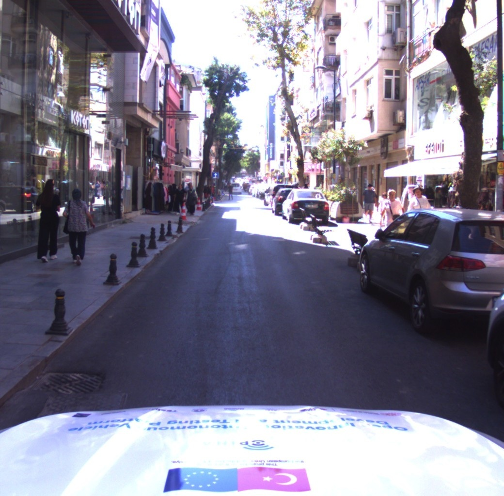
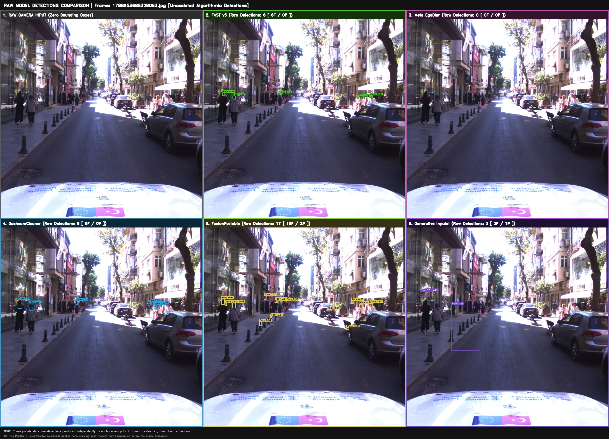
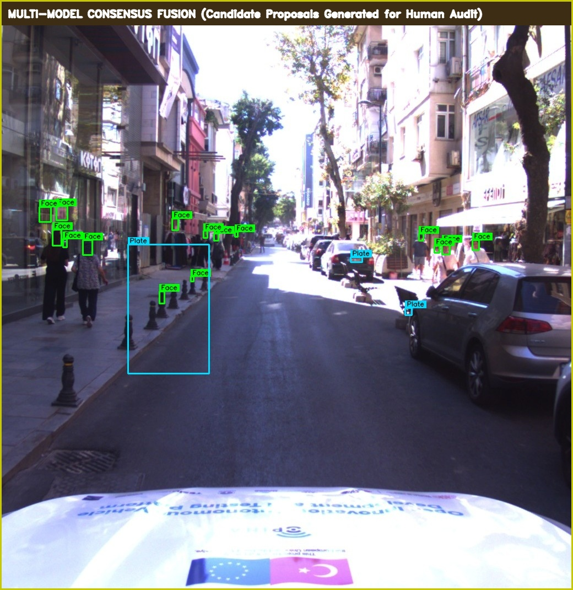
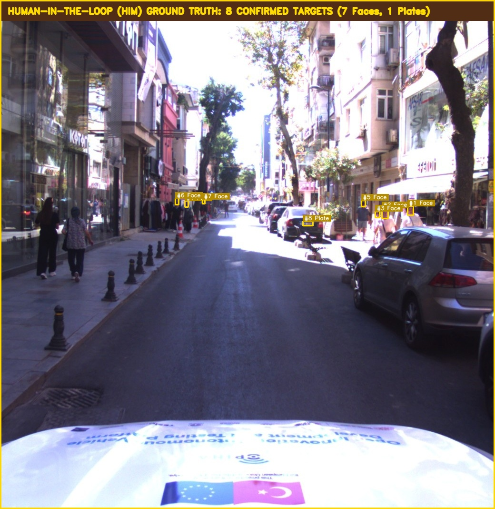
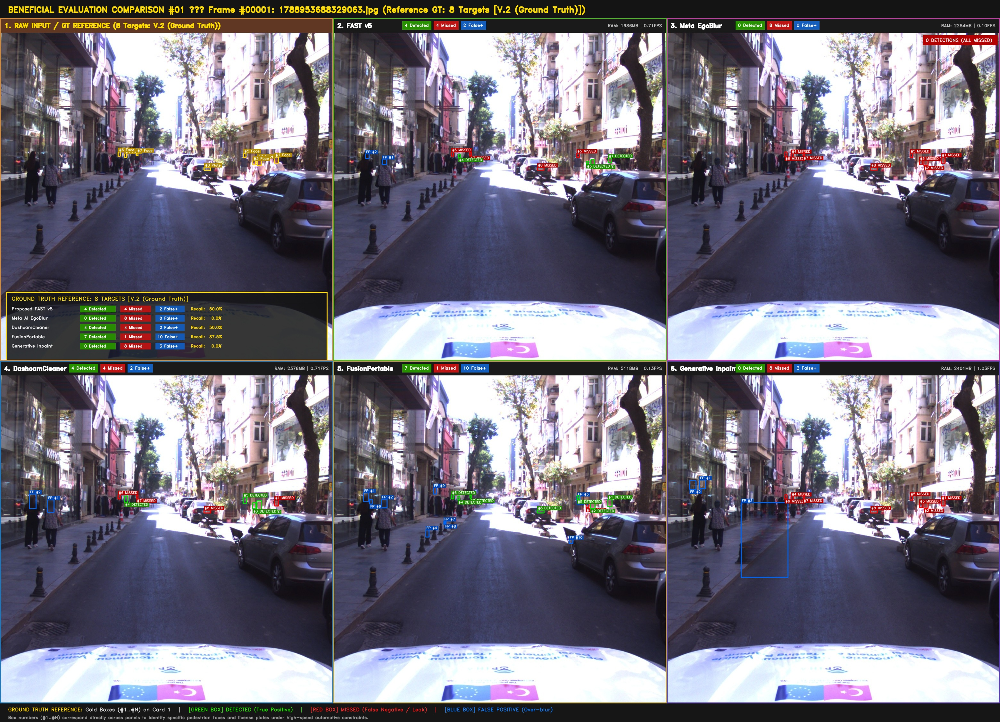

# Frame #01 Visual Audit Trail (High-Density Pedestrian Corridor)
**Frame ID:** `1788953688329063.jpg` | **Scene:** Urban Shopping Street | **GT Targets:** 8

---

## 1. Clean Raw Camera Input (Zero Detections)

---

## 2. Unassisted Model Detections (Before HIM Review)

- **FAST v5:** 6 raw detections (4 faces, 2 plates)
- **Meta AI EgoBlur:** 0 detections (complete multi-scale distance collapse)
- **DashcamCleaner:** 6 detections (4 faces, 2 plates)
- **FusionPortable:** 17 detections (10 faces, 7 plates)
- **Generative Inpaint:** 3 detections (3 faces, 0 plates)

---

## 3. Consensus Fusion vs. Human-in-the-Loop (HIM) Review

| Stage A: Consensus Fusion (Pre-Review) | Stage B: Certified HIM Ground Truth (Post-Review) |
| :---: | :---: |
|  |  |
| **All ensemble candidates combined** | **8 Certified Ground Truth Targets** |

---

## 4. Final Benchmark Evaluation (Against HIM Reference)

- 🟩 **Green Box:** True Positive (Detected / Blurred)
- 🟥 **Red Box:** False Negative (Missed / Privacy Leak)
- 🟦 **Blue Box:** False Positive (Over-blur / Hallucination)

### Performance Breakdown:
| Pipeline Architecture | Detected (TP) 🟩 | Missed (FN) 🟥 | False+ (FP) 🟦 | Recall |
| :--- | :---: | :---: | :---: | :---: |
| **Proposed FAST v5** | **4** | **4** | **2** | **50.0%** |
| **Meta AI EgoBlur** | 0 | 8 | 0 | 0.0% |
| **DashcamCleaner** | 4 | 4 | 2 | 50.0% |
| **FusionPortable** | 7 | 1 | 10 | 87.5% |
| **Generative Inpaint** | 0 | 8 | 3 | 0.0% |
