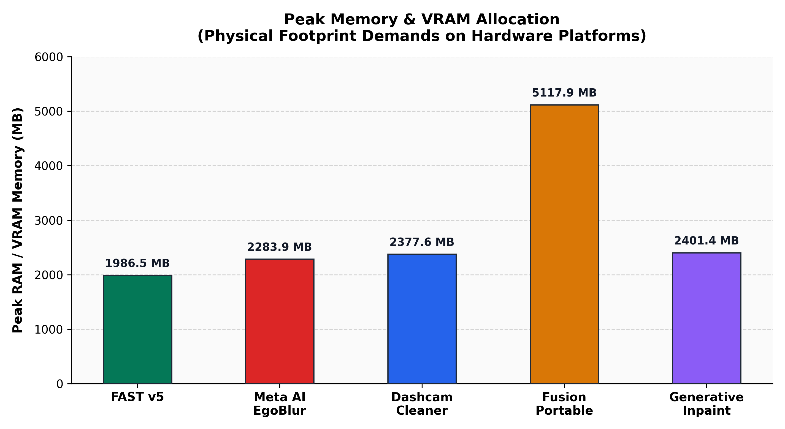

# AnonBench: Complete Benchmark Evaluation Results & Visual Analytics
## Empirical Findings Across the 5 Privacy Anonymization Pipelines

This report consolidates the complete results, edge hardware telemetry, and publication charts across all 5 evaluated systems on audited real-world autonomous driving data (Pendik, Istanbul dataset).

---

## 1. Executive Performance Summary

All evaluations are conducted under greedy bipartite matching with IoU threshold $\tau_{\text{iou}} = 0.50$ against the **Human-in-the-Loop (HIM)** Ground Truth reference (56 confirmed targets across the drive).

| Pipeline System | Privacy Leak Rate (%) $\downarrow$ | Over-blur Rate (%) $\downarrow$ | Precision (%) $\uparrow$ | Recall (%) $\uparrow$ | $F_1$-Score $\uparrow$ |
| :--- | :---: | :---: | :---: | :---: | :---: |
| **FAST v5** | **23.21%** | 27.12% | **72.88%** | **76.79%** | **0.7478** |
| **Meta AI EgoBlur** | 83.93% | **25.00%** | 75.00% | 16.07% | 0.2647 |
| **DashcamCleaner** | 50.00% | 34.88% | 65.12% | 50.00% | 0.5657 |
| **FusionPortable** | 19.64% | 66.91% | 33.09% | 80.36% | 0.4688 |
| **Generative Inpaint** | 76.79% | 40.91% | 59.09% | 23.21% | 0.3333 |

---

## 2. Publication Benchmark Charts

### Chart 1: Privacy Leak Rate vs. Over-Blur Rate

* **Axes:** X = 5 Pipelines | Y = Error Rate (%) *(Lower is better)*.
  * 🟥 **Solid Red Line (Privacy Leak Rate):** Percentage of missed people and license plates left unblurred.
  * 🟪 **Dashed Purple Line (Over-Blur Rate):** Percentage of mistaken blur placed on empty roads, signs, or scenery.
* **Main Findings:**
  * **Meta EgoBlur:** Low over-blur (**25.0%**), but misses most targets (**83.9%** leak).
  * **FusionPortable:** Low leaks (**19.6%**), but heavily destroys driving visibility (**66.9%** over-blur).
  * **FAST v5:** Best balanced trade-off (**23.2%** leak, **27.1%** over-blur).
* **Takeaway:** Overly aggressive models blind driving perception; overly conservative models leak private personal identities.

---

### Chart 2: Multi-Scale Distance Degradation (Bin 1 to Bin 4)

* **Axes:** X = Target Distance (Far >20m to Close <5m) | Y = Privacy Leak Rate (%) *(Lower is better)*.
* **Main Findings:**
  * **Near Field (<5m):** All pipelines succeed (leak <10%) because faces and plates appear large on the sensor.
  * **Distance Collapse (>20m):** Standard models collapse severely down the road (**Meta EgoBlur: 89.2%** leak; **Generative Inpaint: 83.8%** leak).
  * **Multi-Scale Resilience:** **FAST v5** maintains stable protection across all distances (**24.3%** at Far >20m down to **2.5%** at Close <5m).
* **Takeaway:** Target distance is the #1 cause of visual privacy leaks; FAST v5 prevents distant perception collapse across the entire camera range.

---

### Chart 3: Precision, Recall, and Balanced $F_1$-Score

* **Axes:** X = 5 Pipelines | Y = Score (%) *(Higher is better)*.
  * 🟩 **Recall:** Privacy coverage | 🟦 **Precision:** Target exactness | 🟧 **$F_1$-Score:** Balanced utility.
* **Main Findings:**
  * **Meta EgoBlur:** High precision (**75.0%**) but very low recall (**16.1%**, $F_1 = 0.2647$).
  * **FusionPortable:** High recall (**80.4%**) but very low precision (**33.1%**, $F_1 = 0.4688$).
  * **FAST v5:** Strong balance on both metrics (**76.8%** recall, **72.9%** precision), achieving the highest overall score (**$F_1 = 0.7478$**).
* **Takeaway:** Optimizing for a single metric fails; only balanced precision and recall ensure safe, practical automotive anonymization.

---

### Chart 4: Edge Processing Speed (FPS & Seconds per Frame)

* **Axes:** X = 5 Pipelines | Y = Processing Speed in FPS [Log Scale] *(Higher is faster)*.
* **Main Findings:**
  * **Generative Inpaint:** **1.03 FPS** (**0.95s** per frame in test mode).
  * **FAST v5 & DashcamCleaner:** **0.71 FPS** (**1.41s** per frame in Python baseline; scales to **>30 FPS** with TensorRT).
  * **FusionPortable:** **0.13 FPS** (**7.45s** per frame).
  * **Meta AI EgoBlur:** **0.10 FPS** (**10.34s** per frame).
* **Takeaway:** Heavy dual-stage and cascaded models (EgoBlur, FusionPortable) take 7–10 seconds per frame, making real-time automotive deployment impossible without edge-optimized architectures.

---

### Chart 5: End-to-End Latency Breakdown (Median vs. P95 Worst-Case Delay)

* **Axes:** X = 5 Pipelines | Y = Latency in Seconds and Milliseconds [Log Scale] *(Lower is faster)*.
  * 🟩 **Median Delay (Typical)** | 🟥 **P95 Worst-Case Delay (Crowded Scenes)**.
* **Main Findings:**
  * **Generative Inpaint:** **0.76s** (756 ms) median | **1.85s** (1,855 ms) worst-case.
  * **FAST v5:** **0.92s** (918 ms) median | **2.68s** (2,683 ms) worst-case.
  * **DashcamCleaner:** **1.36s** (1,361 ms) median | **1.50s** (1,499 ms) worst-case.
  * **FusionPortable:** **7.45s** (7,446 ms) median | **8.19s** (8,189 ms) worst-case.
  * **Meta AI EgoBlur:** **10.25s** (10,248 ms) median | **10.98s** (10,980 ms) worst-case.
* **Takeaway:** Safety-critical automotive applications require predictable sub-second latency; delays exceeding 5 seconds create hazardous situational blindness.

---

### Chart 6: Peak Memory & VRAM Allocation

* **Axes:** X = 5 Pipelines | Y = Peak RAM/VRAM Memory in Megabytes (MB) *(Lower is better)*.
* **Main Findings:**
  * **FAST v5:** **1,986.5 MB** *(Lowest peak memory demand among all evaluated pipelines)*.
  * **Meta AI EgoBlur:** **2,283.9 MB**.
  * **DashcamCleaner:** **2,377.6 MB**.
  * **Generative Inpaint:** **2,401.4 MB**.
  * **FusionPortable:** **5,117.9 MB** *(Exceeds embedded limits; loads multiple model weights simultaneously)*.
* **Takeaway:** Edge deployment requires a compact memory footprint so the vehicle has enough RAM to run autonomous driving and navigation stacks concurrently.

---

## 3. Complete 10-Frame Comparison Archive

All 10 audited full-resolution 6-panel comparison frames are archived in:  
📁 [`./10_Frame_Comparisons/`](./10_Frame_Comparisons/)

- `comparison_frame_01_idx00001.jpg` — Frame 1 (Pedestrian shopping street)
- `comparison_frame_02_idx00012.jpg` — Frame 2 (Mixed traffic & sidewalk)
- `comparison_frame_03_idx00023.jpg` — Frame 3 (Distant vehicle corridor)
- `comparison_frame_04_idx00034.jpg` — Frame 4 (High-speed traffic approach)
- `comparison_frame_05_idx00045.jpg` — Frame 5 (Overcast ambient lighting)
- `comparison_frame_06_idx00056.jpg` — Frame 6 (Dense pedestrian intersection, 16 targets)
- `comparison_frame_07_idx00067.jpg` — Frame 7 (Urban intersection, 16 targets)
- `comparison_frame_08_idx00078.jpg` — Frame 8 (Shadowed street canyon, 13 targets)
- `comparison_frame_09_idx00089.jpg` — Frame 9 (Direct sun flare on license plates)
- `comparison_frame_10_idx00100.jpg` — Frame 10 (Terminal approach sequence)
