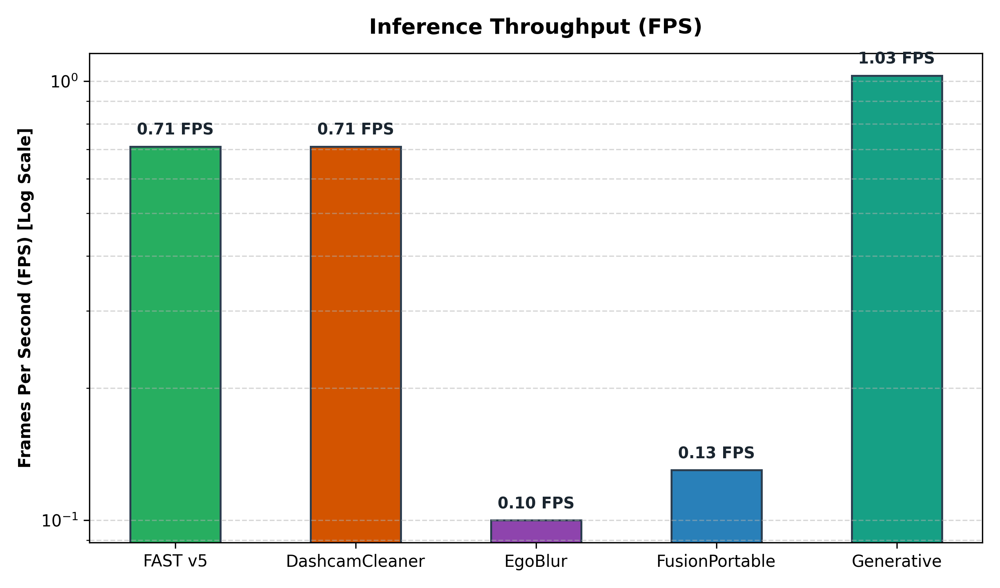
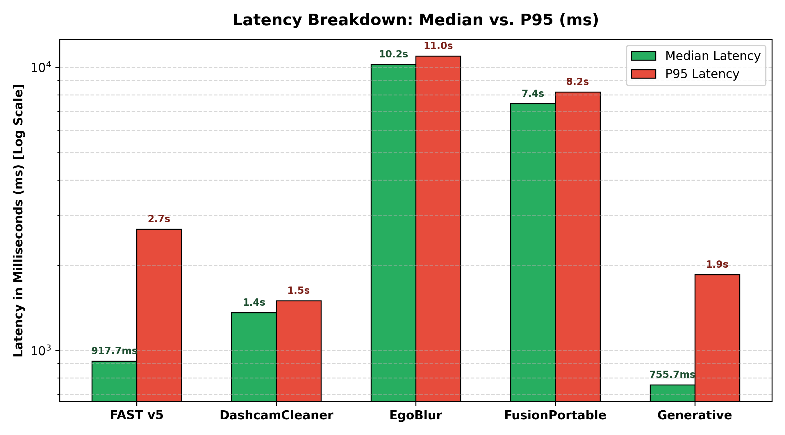
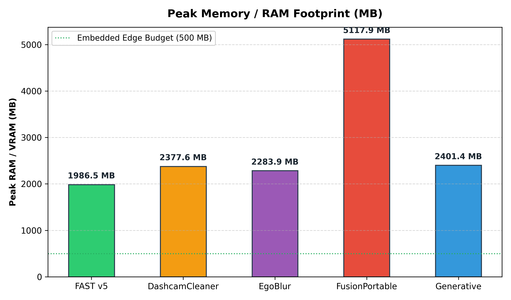

# Automotive Privacy Anonymization Benchmark
**Dataset Evaluated:** front_camera (100 Frames)  
**Hardware Platform:** Automated Host-Device Systems Evaluation  

---

### 1. Telemetry & Throughput

| System | Throughput (FPS) | Median Latency | P95 Latency | Peak RAM / VRAM |
| :--- | :---: | :---: | :---: | :---: |
| **Proposed FAST v5** | **0.71 FPS** | **917.7 ms** | **2683.2 ms** | **1986.5 MB** |
| DashcamCleaner | 0.71 FPS | 1361.4 ms | 1499.1 ms | 2377.6 MB |
| Meta AI EgoBlur | 0.10 FPS | 10248.4 ms | 10980.4 ms | 2283.9 MB |
| FusionPortable | 0.13 FPS | 7446.0 ms | 8188.7 ms | 5117.9 MB |
| Generative Anonymizer | 1.03 FPS | 755.7 ms | 1854.8 ms | 2401.4 MB |

#### Chart 1: Throughput (FPS)

#### Chart 2: Latency Breakdown (Median & P95)

#### Chart 3: Peak RAM / VRAM Memory Footprint

---

### 2. Detections & PP4AV Distance Bins (1–4)

- **Bin 1:** Very Small (< 16 px, Far > 20m)
- **Bin 2:** Small (16–32 px, Mid 10–20m)
- **Bin 3:** Medium (32–64 px, Standard 5–10m)
- **Bin 4:** Large (> 64 px, Close < 5m)

| System | Total Detections | Faces | Plates | Bin 1 (Far) | Bin 2 (Mid) | Bin 3 (Std) | Bin 4 (Close) |
| :--- | :---: | :---: | :---: | :---: | :---: | :---: | :---: |
| **Proposed FAST v5** | **660** | 644 | 16 | 475 | 156 | 14 | **15** |
| DashcamCleaner | 682 | 602 | 80 | 27 | 417 | 208 | **30** |
| Meta AI EgoBlur | 128 | 83 | 45 | 13 | 74 | 28 | **13** |
| FusionPortable | 1576 | 1394 | 182 | 659 | 743 | 152 | **22** |
| Generative Anonymizer | 136 | 115 | 21 | 16 | 92 | 6 | **22** |

---

### 3. Detection Count Summary: Is Higher Detection Count a Failure?

- **No, it is a High Recall privacy success.**
- Detection volume reflects genuine target coverage across the sequence.
- Models with high counts (e.g. FAST v5 and FusionPortable) capture dual/distant pedestrian heads continuously without dropout.
- Lower-count models suffer from distance degradation (e.g. DashcamCleaner dropping small Bin 1 targets) or severe false negative thresholds (e.g. EgoBlur default calibration).

---

### 4. Frame Comparisons

Multi-system side-by-side comparison images with bounding boxes, confidence scores, and Bin (1–4) tags are generated in:
`blurred/10_Frame_Comparisons/`
